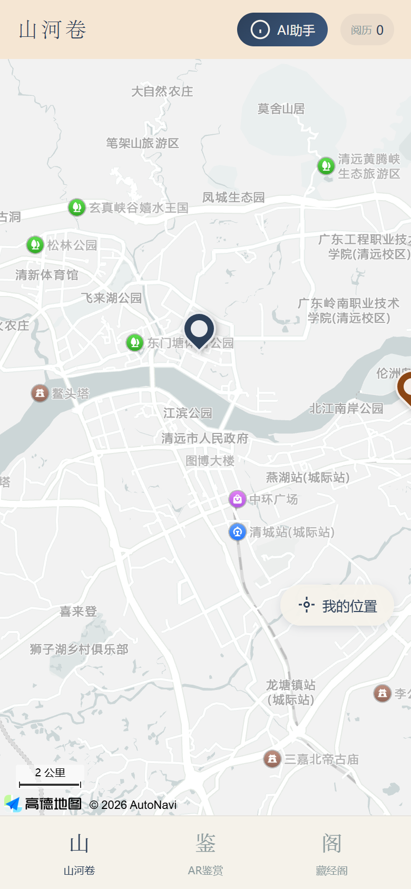
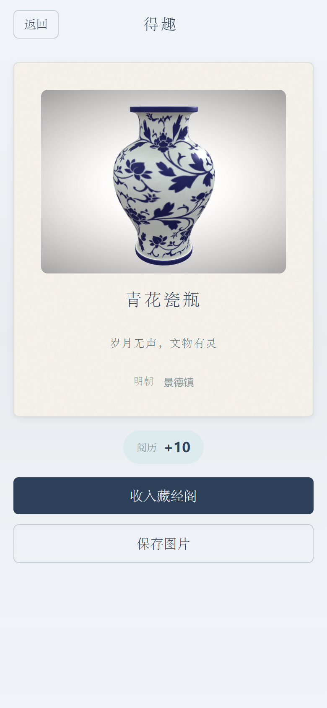
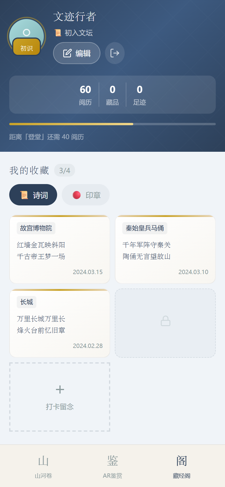

<div align="center">

# 文迹 (WenJi)

**面向文博地标游客的 AI 文化导览 Web 应用 —— 走到哪、讲到哪**


</div>

---

## 1. 项目定位

> **文迹** 是一款面向 **到访文化遗产地标的年轻游客与文博爱好者** 的 Web 应用：用户打开浏览器即可定位周边遗迹，用手机镜头对准文物触发 AR 鉴赏，并随时向 AI 导游「智游」提问。
>
> 核心价值是把一次「到此一游」的打卡，变成 **听得懂（RAG 讲解）→ 玩得进（AR 鉴赏）→ 留得下（阅历/徽章/游记）** 的完整闭环。

- **对用户**：不用下载 App、不用租讲解器，浏览器即可获得有知识库支撑的个性化讲解。
- **对场景**：景点信息与讲解内容解耦，运营侧只需往知识库灌文档，讲解即刻生效。
- **对工程**：AI 能力做了可降级设计，向量检索不可用时自动退化为普通大模型问答，不会整条链路挂死。

---

## 2. 数据与效果摘要

> 作品集项目，不含运营指标（用户量 / 留存 / 转化）。下列均为代码与数据可直接核对的事实。

**RAG 把 AI 从「通用闲聊」约束到「基于知识库作答」**：检索设 3 级降级，任一环节失效退回纯 LLM，不会把对话链路拖死。

### 2.1 RAG 检索链路

| 项 | 数值 |
|---|---|
| 向量模型 / 维度 | 通义千问 `text-embedding-v3` / **1024 维** |
| 召回 | **Top-5**；相似度下限 **0.6**，低于此值不进 Prompt |
| 高相关阈值 | **0.85**，达到则 Prompt 切为「优先基于资料回答」 |
| 知识库 | **3 条**非遗文档（景泰蓝 / 青花瓷 / 京剧，514 字） |
| 存储隔离 | 业务缓存 DB3 / 向量库 DB4 |
| 降级路径 | **3 条**：检索无命中、检索异常、LLM 异常 → 均退回纯 LLM |

### 2.2 内容与交付规模

11 个遗产景点（北京 6 / 清远 5，国家级 7）+ 3 个 AR 文物模型 + 4 套徽章规则；Docker Compose 一键起全栈，GitHub Actions 跑 Maven + Vite 双构建。

### 2.3 效果度量口径

> 知识库仅 3 条、样本不足，**不写未实测的数字**。扩容后按此回填：

| 指标 | 测量方法 |
|---|---|
| 检索命中率 @5 | 30 条问答对 → 逐条检索 → 人工判定 |
| 检索延迟 P95 | 向量化 + 检索耗时打点（不含 LLM 生成） |
| 有 / 无 RAG 事实命中率 | 同题双跑，人工标注对比 |

---

## 3. 演示

**界面截图**（本地运行实拍：Chrome 移动端视口 390×844 @2x，数据来自 11 个种子景点 + 演示账号）

| 山河卷 · 位置探索 | AR 鉴赏 · 演示模式 | 得趣 · 阅历结算 |
|:---:|:---:|:---:|
|  |  |  |
| **藏经阁 · 成长体系** | **启动页** | |
|  |  | |

> AR 截图为「演示模式」（叠加 3D 文物模型），真机需用摄像头对准 `public/targets/targets.mind` 里的识别图。

**在线地址 / API 文档**

- 演示站点：**待部署**（当前仅本地运行）
- API 文档：本地启动后访问 `http://localhost:8080/doc.html`（Knife4j）

---

## 4. 功能特性

| 模块 | 能力 | 说明 |
|------|------|------|
| 山河卷 · 位置探索 | 附近景点 / 地图点亮 | 按经纬度做 GIS 落点判定（`ST_Contains`），本市优先 → 级别优先 → 距离升序；到访即点亮足迹 |
| AR 鉴赏 | 图像识别 + 3D 展示 | MindAR 图像追踪 + A-Frame 渲染 glb 模型（珐琅彩 / 青花瓷 / 青花瓷面具），浏览器直接运行 |
| AI 导游「智游」 | 流式对话 / 多模态 | SSE 流式输出，支持图文输入；LangChain4j `@AiService` 声明式装配 |
| RAG 知识库 | 语义检索增强 | 通义千问 `text-embedding-v3`（1024 维）→ Redis 向量库检索 → 增强 Prompt；检索失败自动降级为普通问答 |
| 藏经阁 · 成长体系 | 阅历 / 等级 / 徽章 | 发游记、打卡自动发放阅历与徽章，积分流水可追溯 |
| 用户与游记 | 登录 / 个人中心 / 游记 | 用户名 + 密码 + 图形验证码登录（后端按 `username` 查库），JWT 无状态认证；游记发布做防重与幂等积分 |

---

## 5. 技术速览

| 层 | 技术选型 |
|----|----------|
| **前端** | Vue 3.5 + Vite 8 + Pinia 3 + Vue Router 4 + Element Plus + Tailwind CSS 4 |
| **AR / 3D** | A-Frame 1.6 + MindAR 1.2.5（CDN 引入）+ Three.js 0.182 |
| **地图 / 可视化** | 高德 AMap JSAPI Loader + Leaflet + ECharts 6 |
| **后端** | Spring Boot 3.3.5 / JDK 21 / MyBatis-Plus 3.5.7 / JJWT 0.11.5 / Knife4j 4.5.0 |
| **AI** | LangChain4j 1.0.1-beta6（OpenAI 兼容模式接入通义千问 qwen-plus）+ Project Reactor（SSE） |
| **数据** | MySQL 8.0（业务数据）/ Redis 7（缓存 DB3、向量库 DB4、聊天记忆） |
| **交付** | Docker Compose（四服务编排）+ GitHub Actions CI |

**关键依赖说明**

- `langchain4j-spring-boot-starter` + `langchain4j-reactor`：声明式 AI Service 与 `Flux<String>` 流式返回。
- `langchain4j-community-redis-spring-boot-starter`：Redis 作为 EmbeddingStore，向量与业务缓存用不同 DB 隔离。
- `langchain4j-document-parser-apache-pdfbox`：知识库支持 PDF 文档解析入库。

---

## 6. 快速开始

### 环境要求

| 软件 | 版本 |
|------|------|
| JDK | 21+ |
| Maven | 3.9+ |
| MySQL | 8.0+ |
| Redis | 7.x |
| Node.js | 20.19+ / 22.12+ |
| Docker + Compose | 可选，用于一键部署 |

### 方式一：Docker Compose（推荐）

```bash
# 1. 准备环境变量（填入通义千问 API Key）
cp .env.example .env

# 2. 启动全部服务
docker compose up -d --build
```

首次启动时 MySQL 会自动执行 `backend/src/main/resources/db/` 下的建表与初始化脚本，无需手动导入。

| 服务 | 地址 |
|------|------|
| 前端 | http://localhost |
| 后端 API | http://localhost:8080 |
| API 文档 | http://localhost:8080/doc.html |

### 方式二：本地开发

```bash
# 1. 初始化数据库（脚本幂等，可重复执行）
mysql -uroot -p < backend/src/main/resources/db/01_schema.sql
mysql -uroot -p < backend/src/main/resources/db/02_init_data.sql

# 2. 配置 AI 密钥（必需，否则 AI 相关接口不可用）
export QWEN_API_KEY=sk-xxxxxxxxxxxxxxxx

# 3. 启动后端（默认 8080；数据库密码见 application.yml，默认 123456）
cd backend && mvn spring-boot:run

# 4. 启动前端（默认 5173，/api 与 /uploads 已代理到 8080）
cd frontend && npm install && npm run dev
```

### 最小运行验证（免登录）

`/map/**` 为白名单接口，无需 Token，一条命令即可验证「后端 + MySQL 数据」链路：

```bash
curl "http://localhost:8080/map/initial?lng=116.4074&lat=39.9042"
```

返回附近景点 JSON（含 `siteId`、`name`、`distance`、`images`、`openingHours` 等字段）即表示环境正常。

### 演示账号

| 用户名 | 手机号 | 密码 |
|--------|--------|------|
| `文迹行者` | `13800138000` | 六位数字，`1` 到 `6` 顺次相连 |

> 后端登录按 **用户名** 查库（不是手机号），三个字段都要填；验证码需人工输入，请通过前端页面登录。

---

## 7. 许可证

本项目基于 [MIT License](https://opensource.org/licenses/MIT) 开源。
